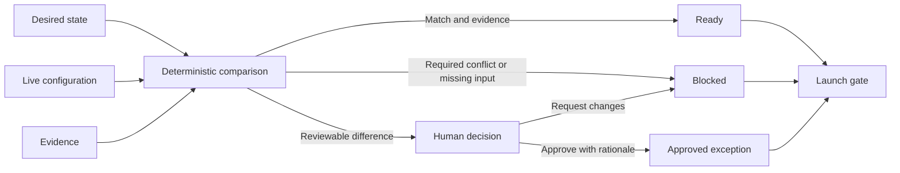

# Implementation Readiness Workbench

A synthetic decision-support product for comparing a customer's desired operating state with a configured live state before launch.

The workbench makes blockers, evidence, exceptions, ownership, and approval decisions visible. It demonstrates how deterministic rules and accountable human judgment can work together without allowing a reassuring average or AI-generated summary to hide unresolved risk.

## Product problem

Implementation teams often hold requirements, configuration, evidence, exceptions, and decisions in separate documents. That makes a basic launch question surprisingly hard to answer:

> Is the configured system actually ready—and what evidence supports that decision?

This project brings those elements into one inspectable workflow.

## What it demonstrates

- desired-versus-live state comparison;
- deterministic validation of missing, matching, and conflicting values;
- evidence requirements for every decision;
- visible blockers and reviewable exceptions;
- named owners and concrete next actions;
- approval or change-request transitions with rationale;
- attributable audit history;
- tests covering rules, transitions, and project-level launch status.

## Workflow



## Run locally

No installation or credentials are required. Use any local static server:

```bash
python3 -m http.server 8000
```

Then open `http://localhost:8000`.

Run the tests and regenerate the checked-in status snapshot:

```bash
npm test
npm run snapshot
```

## Fictional data

The demonstration follows an invented implementation by `Northstar Cloud` for the fictional customer `Harbor & Pine`. All people, requirements, evidence, identifiers, decisions, and dates are synthetic.

The initial state deliberately contains:

- configuration that matches approved requirements;
- a required value that has not been configured;
- a non-negotiable conflict;
- an apparent match with missing evidence; and
- reviewable differences that require a named decision-maker.

The checked-in [status snapshot](examples/status-snapshot.json) is generated from the same deterministic engine used by the interface.

## Repository map

- `index.html` and `styles.css` — responsive product interface.
- `src/engine.js` — readiness rules and approval transitions.
- `src/app.js` — interface rendering and interactions.
- `data/project.json` — fictional project, requirements, evidence, and audit events.
- `tests/engine.test.js` — rule, transition, and launch-gate tests.
- `scripts/generate-snapshot.js` — reproducible status artifact.
- `DECISIONS.md` — product and technical trade-offs.

## Limitations

- Browser decisions are held in memory and reset on refresh.
- The rules cover the fictional schema, not every implementation domain.
- The demonstration has no authentication, authorization, durable database, or production integration.
- Evidence entries are summaries, not real documents.
- The progress visualization is a count of resolved requirements, not a prediction of launch success.
- Passing the synthetic tests establishes consistency with declared rules only; it is not a real-world performance or business-impact claim.

## Privacy and provenance

This is an original portfolio project informed by general experience designing operational workflows. It contains no client data, customer records, employer material, proprietary configuration, or hiring-case content.

## License

MIT
